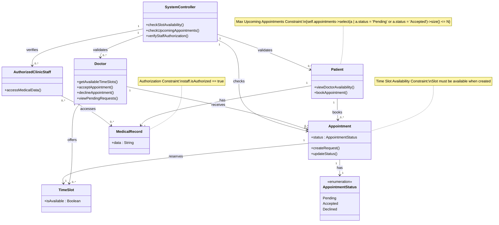

# Clinic Appointments System — Class Diagram & Analysis

## Candidate Domain Classes Table

| Category | Classes |
| :--- | :--- |
| **Explicit** | `Patient`, `Doctor`, `AuthorizedClinicStaff`, `Appointment` |
| **Inferred** | `TimeSlot`, `MedicalRecord`, `AppointmentStatus`, `SystemController` |
| **Rejected** | `Payment`, `Invoice`, `Notification`, `Prescription` |

---

## Mermaid Class Diagram

---

## Business Constraints & Multiplicities

1. **Appointment Status Constraint:**
   - Managed via the `AppointmentStatus` enumeration (`Pending`, `Accepted`, `Declined`).
2. **Maximum Upcoming Appointments Constraint (OCL):**
   - `{self.appointments->select(a | a.status = 'Pending' or a.status = 'Accepted')->size() <= N}` applied to `Patient` to meet Requirement R4.
3. **Authorization Constraint:**
   - Access to `MedicalRecord` requires staff permission validation (`staff.isAuthorized == true`).
4. **Time Slot Availability Constraint:**
   - An `Appointment` can only reserve a `TimeSlot` if `TimeSlot.isAvailable == true`.