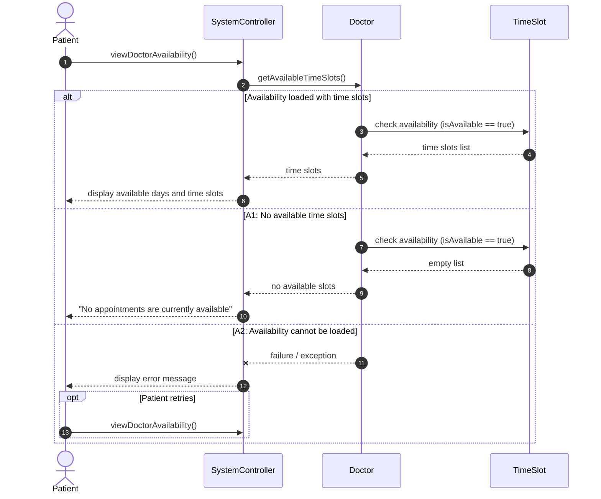
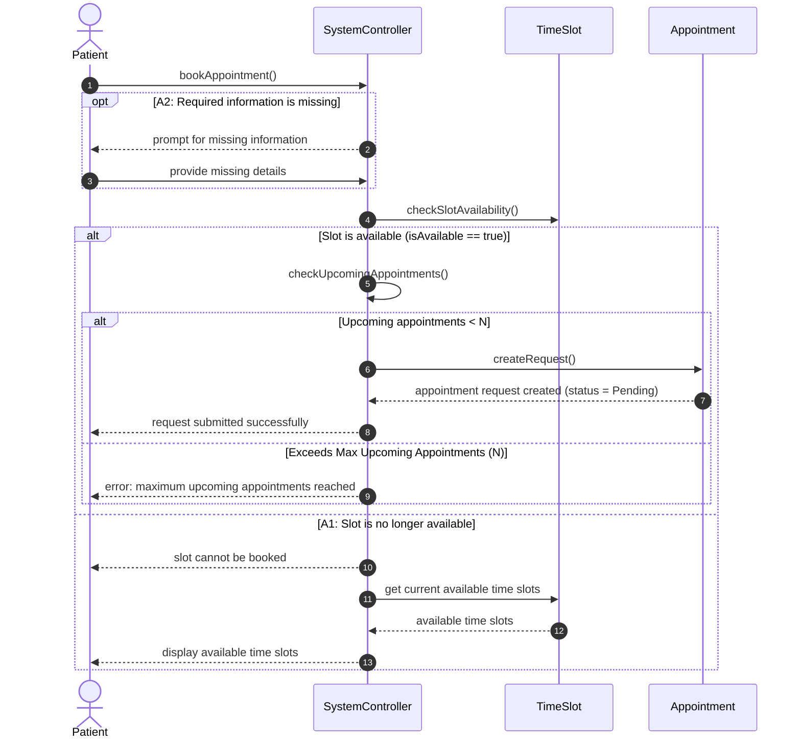
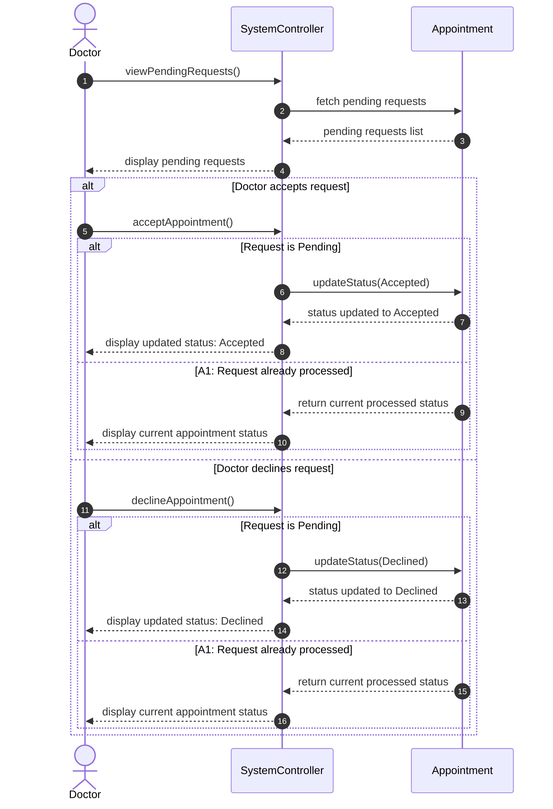
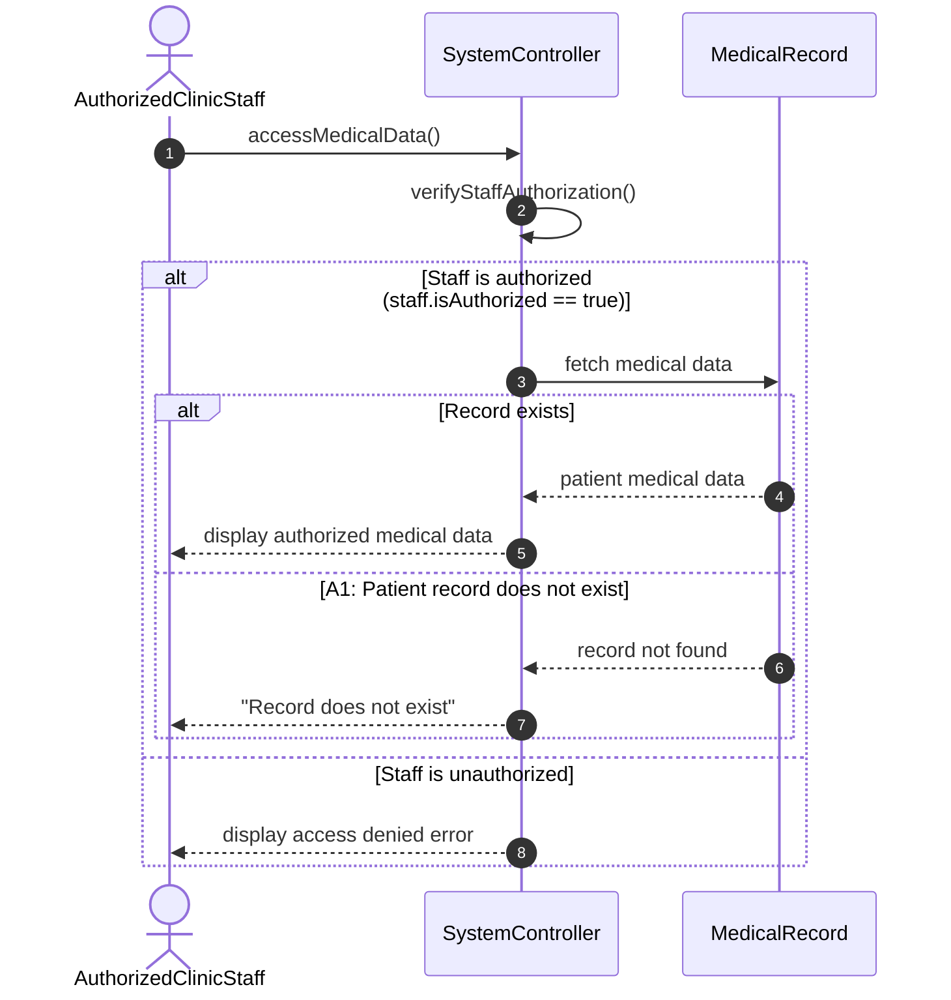

# Clinic Appointments — Sequence Diagrams

## UC-01: View Doctor Availability

## UC-02: Book an Appointment

## UC-03: Accept or Decline an Appointment Request

## UC-04: Access Patient Medical Data

